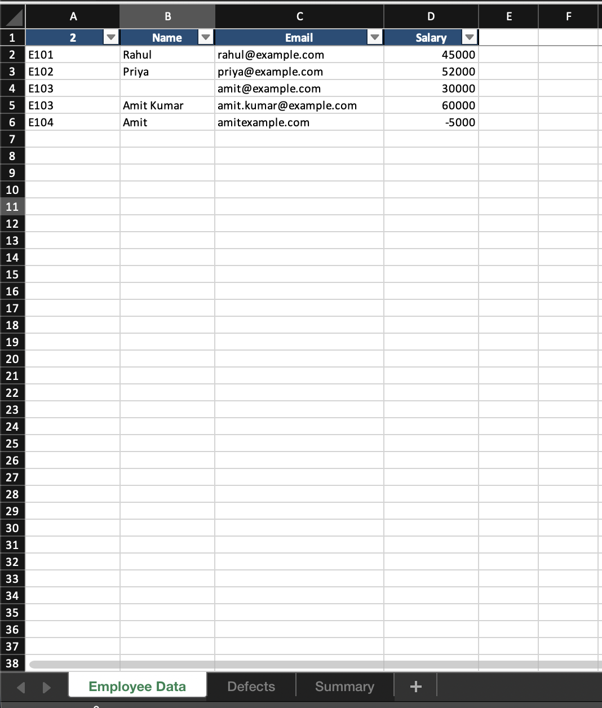
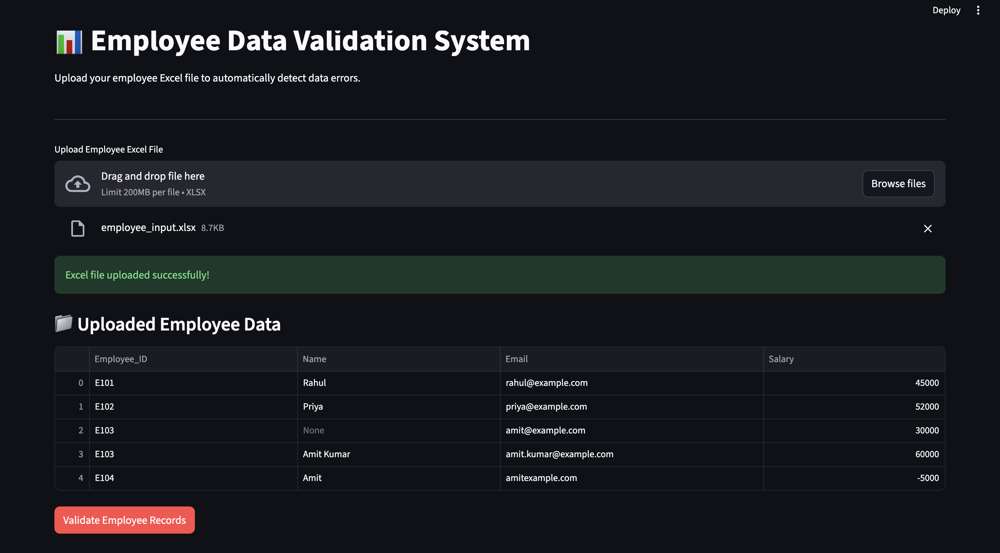
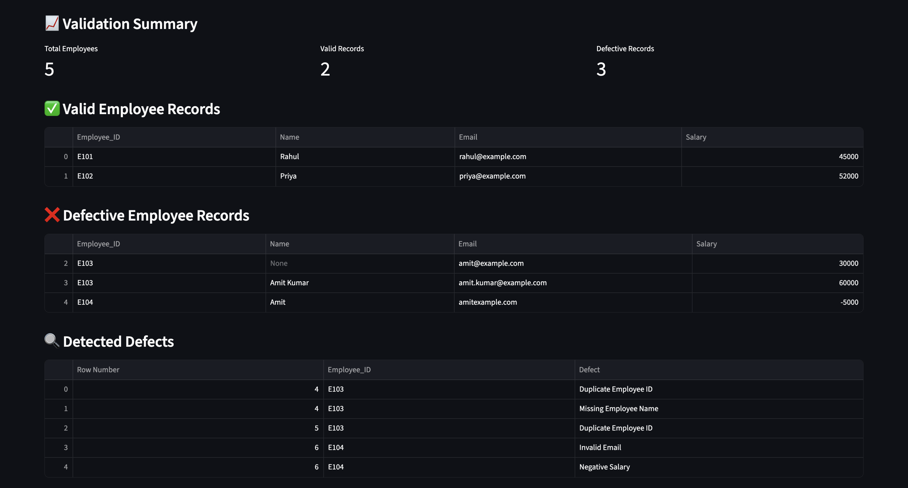

# Employee Data Validation System

A Python project that reads employee records from Excel, validates them, and generates a formatted Excel report.

## Features

- Checks missing employee IDs and names
- Detects duplicate employee IDs (flags both duplicate rows)
- Checks email format
- Detects missing, non-numeric, and negative salaries
- Generates an Excel report with Employee Data, Defects, and Summary sheets
- Includes automated unit tests

## Required Excel columns

The input workbook must contain these columns (spaces in headers are accepted):

- Employee_ID
- Name
- Email
- Salary

## Setup on macOS

Open Terminal in this project folder and run:

```bash
python3 -m venv .venv
source .venv/bin/activate
python3 -m pip install -r requirements.txt
```

## Create sample input

```bash
python3 create_sample_data.py
```

This creates `employee_input.xlsx` with valid and deliberately defective records for testing.

## Run the validation program

```bash
python3 main.py
```

The report is saved as `employee_validation_report.xlsx`.

## Run all unit tests

```bash
python3 -m unittest -v test_validation.py
```

Nine tests are included.

## Project files

- `main.py`: reads the input workbook and creates the report
- `employee_validator.py`: contains the reusable validation logic
- `test_validation.py`: automated unit tests
- `create_sample_data.py`: creates sample Excel input
- `requirements.txt`: required Python packages

- ## Project Preview



## Run the GUI Application

Install the dependencies:

```bash
pip install -r requirements.txt

## Application Screenshots

### Employee Data Upload Interface


### Validation Results
